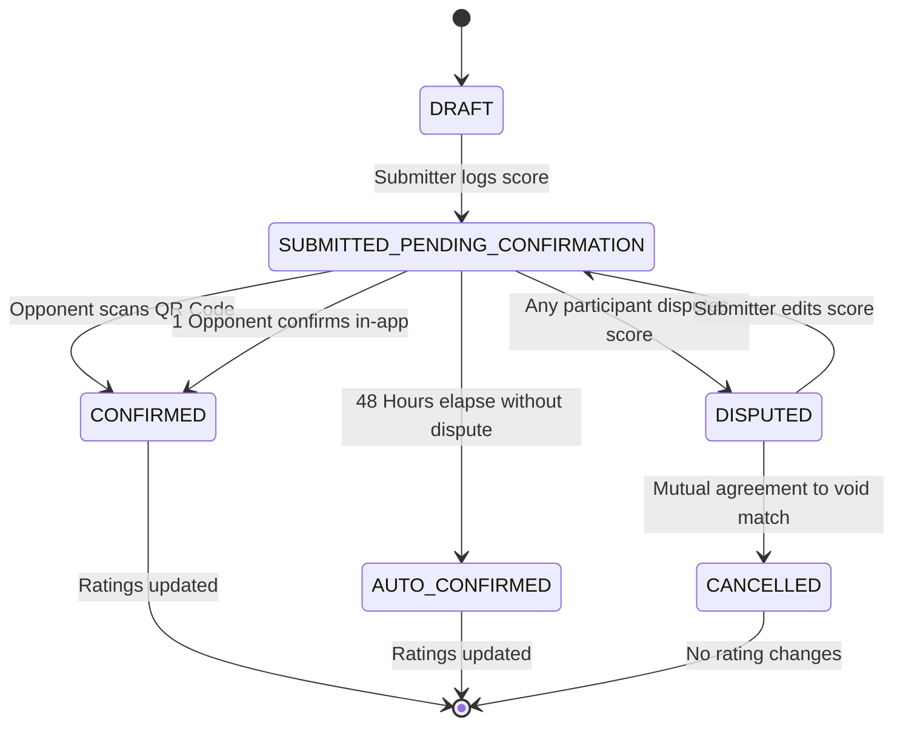

# Padel Up: Comprehensive Technical Specification & Frontier Decision Tree
**Document Version:** 1.0.0  
**Status:** Approved & Settled Architecture  
**Author:** Lead Systems Architect & Product Strategist  
**Target Platform:** Android (Jetpack Compose, Kotlin Coroutines/Flow, Room SQLite, Offline-First)

---

# Part 1: Frontier Grilling Interview & Architectural Decision Tree

In accordance with the directive to stress-test the product architecture and resolve all decisions upfront, this section documents the relentless grilling interview across the six frontier domains of Padel Up. Every question captures the trade-offs, edge cases, and the recommended production-grade decision.

---

### Domain A: Skill Level & Rating System (Playtomic-Style 1.00 – 7.00)

#### ❓ **Q1** – **Rating System Foundation**: Should Padel Up adopt standard Elo, pure Glicko-2, or a specialized Padel Dynamic Rating (PDR) model adapted to the 1.00–7.00 scale with game margin weighting?
- **Option A**: Standard Elo mapped linearly to 1.00–7.00. (Simplistic, ignores rating confidence, treats 7-6 7-6 identical to 6-0 6-0).
- **Option B**: Pure Glicko-2 with rating period batches. (Too heavy for instant local calculation; rating periods don't feel real-time to players immediately checking their phones after a match).
- **Option C (Recommended)**: **Padel Dynamic Rating (PDR)** — A continuous, instant Glicko/TrueSkill-inspired Bayesian logistic model scaled to $[1.00, 7.00]$ with an individual Rating Confidence Factor ($C_i \in [0.10, 1.00]$), Match Margin Weighting ($M$), and 2v2 Pair Level Averaging.
➡️ **Settled Recommendation (Approved)**: Adopt **Option C (PDR)**. Real-time updates immediately upon confirmation are vital for engagement. The model computes an instant delta $\Delta R$ using pair effective ratings, scales by the game differential margin, and dampens or amplifies based on the player's personal rating confidence.

---

#### ❓ **Q2** – **Initial Level Calibration & Cold Start**: How should the app bootstrap a new player's rating before their first competitive match without distorting the global ladder?
- **Option A**: Everyone starts at 1.00. (Destroys match balance; advanced tennis converts crush beginners for months).
- **Option B**: Free manual self-selection from 1.00 to 7.00. (Vulnerable to ego-inflation and intentional sandbagging/smurfing).
- **Option C (Recommended)**: **5-Question Onboarding Quiz** mapping to a provisional baseline $R_0 \in [1.50, 3.25]$ with maximum uncertainty (Confidence $C_0 = 0.20$, provisional match count $N_{prov} = 5$).
  - Questions evaluate: (1) Racket sport background (Tennis, Squash, Badminton, None), (2) Play frequency, (3) Wall rebound comfort (back/side glass), (4) Overhead shot mastery (Bandeja / Víbora / Smash), (5) Matchplay experience.
  - During the first 5 matches, the volatility multiplier ($K$-factor) is $3\times$ higher, allowing the system to rapidly converge the player to their true skill bracket within 3–5 matches.
➡️ **Settled Recommendation (Approved)**: Adopt **Option C**. Caps initial self-selected entry at 3.25 (intermediate) to prevent instant high-level pollution, while provisional volatility allows genuinely skilled players to reach 4.5+ in just a few matches.

---

#### ❓ **Q3** – **2v2 Asymmetric Delta Distribution**: When Team A (e.g., Level 4.20 + Level 2.40) defeats Team B (Level 3.10 + Level 3.10), how should the rating delta be split between the two teammates?
- **Option A**: Identical delta for both teammates. (Rewards high-level smurfs boosting low-level friends and penalizes low-level players unfairly).
- **Option B**: Pure individual point tracking. (Impossible in regular matches where only game scores are recorded).
- **Option C (Recommended)**: **Confidence-Weighted Asymmetric Distribution**. The match expected outcome is calculated using the team mean: $\bar{R}_A = \frac{R_{A1} + R_{A2}}{2}$. The net team delta $\Delta R_{team}$ is then weighted by each player's individual confidence factor $C_i$ and distance from team mean:
  $$\Delta R_i = \Delta R_{team} \times \left(1 + \beta \frac{\bar{R} - R_i}{\bar{R}}\right) \times (1.2 - 0.4 C_i)$$
  A lower-rated provisional player earns slightly more for a win against higher opponents, while a high-rated veteran carries the expectation and gains less.
➡️ **Settled Recommendation (Approved)**: Adopt **Option C**. Encourages mixed-level play while preventing artificial rating boosting.

---

### Domain B: Match Flow & Confirmation State Machine

#### ❓ **Q4** – **Match Confirmation Protocol & Anti-Stall**: How do we prevent submitted matches from lingering in limbo when one casual player forgets to open the app?
- **Option A**: All 3 other players must manually accept before points change. (High failure rate; >40% of matches stall permanently).
- **Option B**: Submitter's score is immediately trusted without confirmation. (Extreme cheating / griefing risk).
- **Option C (Recommended)**: **Fast-Path "1-Opponent OR QR" Rule with 48h Auto-Finalization**.
  1. **Instant On-Court Confirmation (0 seconds)**: Submitter presents an in-app dynamic QR code on their phone screen. Any 1 player from the opposing team scans it $\rightarrow$ Match instantly transitions to `CONFIRMED`.
  2. **Async Notification Path**: Submitter submits remotely $\rightarrow$ Push notification sent to all 3 participants. As soon as **at least 1 opponent** taps "Confirm", status becomes `CONFIRMED`.
  3. **Auto-Confirm Timeout**: If no dispute is lodged within 48 hours, state automatically transitions to `AUTO_CONFIRMED`.
➡️ **Settled Recommendation (Approved)**: Adopt **Option C**. Solves on-court friction completely with QR code while providing a graceful async fallback.

---

#### ❓ **Q5** – **Dispute State Machine**: What happens when a player flags a score as inaccurate?
- **Option A**: Delete the match immediately. (Vulnerable to sore losers cancelling legitimate losses).
- **Option B (Recommended)**: **Freezing Dispute State Machine (`DISPUTED`)**.
  - Any participant can tap "Dispute Score" within the 48-hour window, requiring a reason (e.g., "Wrong score", "I didn't play", "Wrong partner").
  - The match enters `DISPUTED` status; no rating changes are applied.
  - The submitter receives an instant alert with two options:
    1. **Edit Score**: Submitter adjusts score $\rightarrow$ status resets to `PENDING_CONFIRMATION` with a new 48-hour clock.
    2. **Mutual Cancellation**: If 2 or more players vote to cancel, status becomes `CANCELLED`.
➡️ **Settled Recommendation (Approved)**: Adopt **Option B**. Eliminates rating manipulation and prevents hostile match invalidation.

---

### Domain C: The Americano & Mexicano Tournament Engine

#### ❓ **Q6** – **Scheduling Constraint Satisfaction (The Social Golfer Problem)**: How should the tournament engine generate pairings for arbitrary player counts $N$ and court counts $C$?
- **Option A**: Pure random shuffling each round. (Terrible UX; players frequently partner with the same person twice and sit out unevenly).
- **Option B (Recommended)**: **Hybrid Deterministic Lookup Table + Simulated Annealing CSP Solver**.
  - For standard counts ($N \in \{4, 8, 12, 16\}$ with $C = N/4$), use pre-computed, mathematically proven Whist Tournament cyclic designs that guarantee **exact partner uniqueness** (every player partners with every other player at most once).
  - For irregular counts ($N = 5, 6, 7, 9, 10, 11, 13, 14, 15$) and custom round counts $R$, use a real-time greedy Constraint Satisfaction Problem (CSP) solver:
    - **Hard Constraint 1**: No player can play on two courts in the same round.
    - **Hard Constraint 2**: A player cannot partner with themselves or play against themselves.
    - **Cost Function Minimization**:
      $$\text{Cost} = w_1 \sum (\text{Partnerships}_{ij} - 1)^2 + w_2 \sum (\text{Byes}_i - \bar{\text{Byes}})^2 + w_3 \text{Var}(\text{Oppositions}_{ij})$$
  - Computes optimal round schedules in $<15\text{ms}$ on Android ARM64 CPU.
➡️ **Settled Recommendation (Approved)**: Adopt **Option B**. Ensures flawless schedules regardless of whether a group has 8, 9, or 13 players.

---

#### ❓ **Q7** – **Score Format & Conservation**: How should Americano match scores be entered and validated?
- **Option A**: Standard tennis/padel sets (e.g., 6-4, 7-5). (Breaks Americano math; tournament points cannot be summed linearly across varying set lengths).
- **Option B (Recommended)**: **Fixed-Target Score Conservation (e.g., 24 or 32 points total)**.
  - A tournament has a configured `points_per_match` parameter (Standard default: 32 points; Quick format: 24 or 21 points; Short format: 16 points).
  - Score constraint: $\text{Score}_1 + \text{Score}_2 = \text{Target}$.
  - **Frictionless UI**: The organizer or player adjusts Team 1's score using an interactive stepper or slider; Team 2's score automatically updates to $\text{Target} - \text{Score}_1$. Entering 20 automatically assigns 12 to the opponents.
  - Every point scored by a pair is credited individually to both players on that pair.
➡️ **Settled Recommendation (Approved)**: Adopt **Option B**. Guarantees zero math errors and fast 2-second score entry.

---

#### ❓ **Q8** – **The Mexicano Variant (Dynamic Ladder Americano)**: How should Mexicano dynamic pairings be computed after each round?
- **Option A**: Static pre-scheduled rounds like Americano. (Not a Mexicano; misses the essence of the format).
- **Option B (Recommended)**: **Dynamic Tiered Parity Pairing with Partner History Guard**.
  - In Mexicano, Round 1 is randomized or seeded.
  - For Round $R+1$, all $N$ players are sorted by current cumulative tournament leaderboard rank ($1^{\text{st}}$ to $N^{\text{th}}$).
  - Court 1 (Top Tier): Ranks $\{1, 2, 3, 4\}$. Default balance pairing is $(1 + 4)$ vs $(2 + 3)$ to ensure competitive parity.
  - Court 2: Ranks $\{5, 6, 7, 8\}$ paired as $(5 + 8)$ vs $(6 + 7)$.
  - **History Guard**: If $(1, 4)$ have already partnered in an earlier round, swap to $(1 + 3)$ vs $(2 + 4)$ or $(1 + 2)$ vs $(3 + 4)$ to maintain partner diversity while preserving tier closeness.
➡️ **Settled Recommendation (Approved)**: Adopt **Option B**. Produces thrilling, closely matched games where the best players continually play each other without repetitive partnerships.

---

### Domain D: Offline Tournament Mode & Solo Organizer Workflow

#### ❓ **Q9** – **Guest Players & Accountless Operation**: Should all tournament players be required to download the app and create an account?
- **Option A**: Yes, mandatory sign-up via phone/email for all participants. (Kills adoption; casual Friday night padel groups refuse to wait 15 minutes for 12 people to register).
- **Option B (Recommended)**: **Zero-Barrier Local Guest Roster**.
  - The solo organizer can create an entire 16-player tournament in under 60 seconds by typing or pasting names ("Carlos", "Mateo", "Diego", "Sofi").
  - Guest records exist locally in Room SQLite (`is_guest = 1`).
  - If a guest player later downloads Padel Up, their past tournament history can be claimed/merged via a QR claim code.
➡️ **Settled Recommendation (Approved)**: Adopt **Option B**. Frictionless onboarding is the single highest conversion driver.

---

#### ❓ **Q10** – **Data Isolation Between Local Tournaments and Global Ratings**: Should offline / casual Americano tournaments alter a player's official 1.00–7.00 competitive level?
- **Option A**: Yes, calculate rating deltas from Americano points. (Destroys rating integrity; Americano has arbitrary partner rotations, mixed genders, and fixed points which invalidate standard 2v2 win/loss modeling).
- **Option B (Recommended)**: **Strict Global Isolation (`affects_global_rating = false`)**.
  - Americano/Mexicano tournaments maintain their own self-contained Tournament Standings, Tournament Points, and optional Group-Specific Leaderboard trophies.
  - They NEVER modify the global 1.00–7.00 skill level unless the match is an official sanctioned competitive doubles match.
➡️ **Settled Recommendation (Approved)**: Adopt **Option B**. Protects the competitive rating system from skew and casual variance.

---

#### ❓ **Q11** – **Export & Sharing Mechanics**: How does the solo organizer share tournament results with participants after the event?
- **Option A**: Plain text WhatsApp copy-paste. (Unprofessional, messy formatting).
- **Option B (Recommended)**: **Multi-Format Export Suite**.
  1. **Visual Social Poster (Story/Card)**: High-resolution bitmap rendered natively via Jetpack Compose GraphicsLayer / Picture containing Podium (Gold, Silver, Bronze), winner avatar/name, tournament stats, and Padel Up branding, formatted for Instagram Stories / WhatsApp Status.
  2. **Detailed Standings Table (CSV / PDF)**: Full round-by-round matrix.
  3. **Compressed State QR Code**: Allows another player with Padel Up to scan and clone the entire tournament history read-only.
➡️ **Settled Recommendation (Approved)**: Adopt **Option B**. Viral social sharing turns every tournament into an organic growth loop.

---

### Domain E: Group Leaderboards & Rivalry Engine

#### ❓ **Q12** – **Group Context vs Global Ladder**: How should padel clubs and social friend groups track their internal hierarchy?
- **Option A**: Only display the global level. (Boring; doesn't show who is currently in form within the weekly Wednesday night group).
- **Option B (Recommended)**: **Dedicated Group Dynamics Engine**.
  - Each Group (`groups`) maintains its own internal leaderboard filtered exclusively to matches and tournaments played within that group.
  - Group metrics: Group Win Rate, Americano Trophies Won, Form Guide (last 5 matches: W/L/W/W/L), and Point Differential.
➡️ **Settled Recommendation (Approved)**: Adopt **Option B**.

---

#### ❓ **Q13** – **The Rivalry & Chemistry Engine**: How should Head-to-Head (H2H) statistics be calculated between any two players?
- **Option A**: Basic win/loss counter.
- **Option B (Recommended)**: **Dual-Perspective Matrix: Partnership Chemistry vs Head-to-Head Rivalry**.
  - **As Teammates ("Chemistry")**: Matches played together, Win %, Average games won, "Golden Duo" rating.
  - **As Opponents ("Rivalry")**: Head-to-head match record ($W - L$), game differential, average score, "Nemesis" badge.
➡️ **Settled Recommendation (Approved)**: Adopt **Option B**. Creates immense conversational engagement and banter among players.

---

### Domain F: Data Architecture & Offline-First Sync

#### ❓ **Q14** – **Database Technology & Threading**: What local storage stack guarantees zero-deadlock, zero-lag performance on ARM64 Android?
- **Option A**: SharedPreferences / Proto DataStore for everything. (Incapable of complex relational queries for round-robin tournaments, rivalries, and stats).
- **Option B (Recommended)**: **Room SQLite 2.6+ with WAL Mode, Foreign Key Constraints, and Kotlin Coroutines/Flows**.
  - Room provides compile-time query verification, reactive `Flow<List<T>>` UI updates, and atomic transactional writes.
  - Write-Ahead Logging (`PRAGMA journal_mode=WAL`) enables concurrent reads while writing tournament rounds in background dispatchers (`Dispatchers.IO`).
➡️ **Settled Recommendation (Approved)**: Adopt **Option B**.

---

#### ❓ **Q15** – **Sync Abstraction & Cloud Pluggability**: How do we ensure the app functions 100% offline today while making Supabase/Firebase cloud sync a drop-in replacement later?
- **Option A**: Directly embed Supabase SDK calls inside Compose UI ViewModels. (Brittle, fails completely without Wi-Fi, tightly couples UI to network).
- **Option B (Recommended)**: **Clean Architecture Repository Pattern with Sync Engine State Machine**.
  - ViewModels interact strictly with Domain Repositories (`MatchRepository`, `TournamentRepository`, `UserRepository`).
  - Room Database is the **single source of truth** (Local-First).
  - Each entity possesses metadata fields: `sync_status` (`SYNCED`, `PENDING_INSERT`, `PENDING_UPDATE`, `PENDING_DELETE`) and `updated_at`.
  - A pluggable `RemoteSyncService` interface is stubbed cleanly. When cloud credentials are injected, the sync engine synchronizes mutations using a delta-vector / timestamp strategy without altering a single line of UI code.
➡️ **Settled Recommendation (Approved)**: Adopt **Option B**. Guarantees flawless offline reliability and zero architectural debt.

---

# Part 2: Product Requirements Document (PRD) & Technical Specification

---

## 1. Problem Statement
Padel is the fastest-growing racket sport globally, yet players and tournament organizers are stranded with fragmented, frustrating tools:
1. **Broken Tournament Organization**: Running a casual 8-to-16-player Americano tournament at a club currently requires manual pen-and-paper brackets or clunky subscription web tools that require every single player to register an account before starting.
2. **Arbitrary & Inaccurate Skill Ratings**: Outside of major proprietary club platforms (e.g., Playtomic), players lack a credible, mathematically sound way to track their 1.00–7.00 skill level across friendly and competitive matches with transparent calculation.
3. **Friction-Riddled Match Logging**: Entering a 2v2 doubles match requires tedious coordination; submitted scores sit unconfirmed for days, leading to disputes and abandoned stats.
4. **Zero Offline Resilience**: Most apps fail completely when cell reception drops inside indoor padel clubs or metal-roofed sports halls.

---

## 2. Solution
**Padel Up** is a native, offline-first Android application designed for padel players, social groups, and tournament directors:
- **Instant Americano & Mexicano Engine**: Effortlessly schedule, manage, and score tournaments for 4 to 24+ players with mathematically optimal partner rotation, automatic bye distribution, and real-time live standings on a single phone.
- **Dynamic Skill Level System (1.00 – 7.00)**: A transparent, Glicko/Bayesian-based rating model with onboarding calibration, margin-of-victory weighting, and confidence decay.
- **Fast-Path On-Court Confirmation**: Dynamic QR-code scanning allows opponents to verify match scores at the net in 2 seconds, backed by an asynchronous 48-hour auto-confirm fallback.
- **Group Societies & Rivalry Stats**: Dedicated group leaderboards with deep head-to-head metrics ("Chemistry" as partners vs "Rivalry" as adversaries).
- **100% Local-First Architecture**: Built on Room SQLite, enabling full functionality with zero network connectivity and instant visual social card export for WhatsApp/Instagram.

---

## 3. User Stories

### Persona 1: Tournament Director / Social Organizer (Taco)
1. *As an organizer*, I want to create an Americano tournament in under 30 seconds by typing player names, so that our group can begin playing immediately without forcing anyone to download an app.
2. *As an organizer*, I want to configure the tournament points target (16, 21, 24, or 32 points) and court count, so that matches fit our reserved court booking time.
3. *As an organizer*, I want the app to automatically balance sit-out rounds (byes) when we have an odd player count (e.g., 5, 7, 9, 11 players), so that every participant gets an equal number of games.
4. *As an organizer*, I want the scheduling algorithm to guarantee that players rarely or never partner with the same person twice, so that the event is socially dynamic.
5. *As an organizer*, I want to run a Mexicano tournament where subsequent rounds dynamically pit top-ranked players against each other while balancing pairs (1st + 4th vs 2nd + 3rd), so that matches remain intensely competitive.
6. *As an organizer*, I want entering Team 1's score to automatically compute Team 2's score (e.g., entering 18 in a 32-point game auto-fills 14), so that I can log scores in 2 seconds without mental math.
7. *As an organizer*, I want to export a high-resolution, branded social story graphic of the podium and final standings, so that I can post it directly to our group's WhatsApp chat or Instagram.
8. *As an organizer*, I want the tournament to run entirely offline with zero internet connectivity, so that basement indoor courts with zero cell service never disrupt the event.
9. *As an organizer*, I want to be able to edit a previously completed round's score if a mistake was made, with the leaderboard automatically recalculating downstream.

### Persona 2: Competitive Padel Player (Lucia)
10. *As a competitive player*, I want an initial onboarding questionnaire to assess my background (tennis experience, wall rebound comfort, bandejas), so that I start with an accurate baseline level instead of grinding from 1.00.
11. *As a competitive player*, I want to see my dynamic skill level on a 1.00 to 7.00 scale with two decimal places, so that I have a clear, measurable indicator of my progression.
12. *As a competitive player*, I want dominant victories (e.g. 6-1, 6-0) to yield a higher rating increase than narrow tiebreak wins (e.g. 7-6, 6-7, 7-6), so that score margin is properly rewarded.
13. *As a competitive player*, I want to inspect my rating history chart over time with before/after match deltas, so that I understand exactly why my rating changed.
14. *As a competitive player*, I want my rating to have a confidence factor that stabilizes after 20 matches, preventing single bad games from drastically tanking an established rank.
15. *As a competitive player*, I want to present a dynamic QR code on my screen after logging a match, so that my opponents can scan it and confirm the result on the spot.

### Persona 3: Casual & Club Player (Mateo)
16. *As a casual player*, I want to log friendly matches that do not affect my competitive level, so that I can play with beginner friends without rating anxiety.
17. *As a casual player*, I want to receive an in-app notification when someone logs a match involving me, with a 1-tap "Confirm" or "Dispute" option.
18. *As a casual player*, I want matches to automatically confirm after 48 hours if no one disputes them, so that forgotten matches don't stay pending forever.
19. *As a casual player*, I want to dispute an incorrectly entered score, freezing rating changes until the submitter corrects it.
20. *As a casual player*, I want to view my Head-to-Head record against any specific friend, showing our win/loss record as opponents and our synergy as partners.

### Persona 4: Group Administrator & Community Leader (Sofia)
21. *As a group admin*, I want to create a named Padel Group (e.g., "Wednesday Night Padeleros") with an invite code, so that all our matches and tournaments are aggregated in one hub.
22. *As a group admin*, I want a group-specific leaderboard that only tallies matches played between group members, so that our internal club championship is distinct from global stats.
23. *As a group admin*, I want to see fun automated superlatives (e.g., "The Wall" for best defensive point diff, "Golden Duo" for highest win-rate pair, "Nemesis" for frequent victor), so that our group chats stay lively.
24. *As a group admin*, I want to convert guest players from previous tournaments into registered user profiles when they join the group, preserving their match history.
25. *As a user*, I want the app to launch instantly and cache all data locally, with background sync queuing updates until a network connection is restored.

---

## 4. Mathematical Model: Padel Dynamic Rating (PDR) System

### 4.1 Rating Scale & Semantics
The rating scale spans $[1.00, 7.00]$:
- **1.00 – 1.99**: Novice (learning rules, positioning, basic contact, struggles with glass rebounds).
- **2.00 – 3.49**: Intermediate (consistent rallies, basic wall play, functional bandeja, flat serves).
- **3.50 – 4.99**: Advanced (tactical glass play, víboras, bajada de pared, offensive net control).
- **5.00 – 5.99**: Expert / National Competitive (high shot consistency, spin control, fast transition play).
- **6.00 – 7.00**: Elite / Professional (WPT / Premier Padel caliber).

### 4.2 Onboarding Calibration Function
Initial rating $R_0$ is derived from 5 discrete survey vectors:
$$R_0 = 1.25 + w_{\text{racket}} + w_{\text{freq}} + w_{\text{wall}} + w_{\text{overhead}} + w_{\text{comp}}$$
Where:
- $w_{\text{racket}} \in \{0.00 \text{ (None)}, 0.15 \text{ (Badminton/Squash)}, 0.35 \text{ (Tennis)}\}$
- $w_{\text{freq}} \in \{0.00 \text{ (First time)}, 0.10 \text{ (Monthly)}, 0.25 \text{ (Weekly)}, 0.40 \text{ (Multiple/week)}\}$
- $w_{\text{wall}} \in \{0.00 \text{ (Avoid walls)}, 0.20 \text{ (Basic back glass)}, 0.35 \text{ (Comfortable with side/double glass)}\}$
- $w_{\text{overhead}} \in \{0.00 \text{ (Basic smash)}, 0.20 \text{ (Controlled bandeja)}, 0.35 \text{ (Offensive víbora/rulo)}\}$
- $w_{\text{comp}} \in \{0.00 \text{ (Only casual)}, 0.25 \text{ (Played tournaments)}\}$

Bounds: $R_0 \in [1.25, 2.95]$. Initial Confidence $C_0 = 0.20$ (Provisional).

### 4.3 Pair Effective Rating & Win Expectancy
For a doubles match (Team A: players $A_1, A_2$; Team B: players $B_1, B_2$):
$$\bar{R}_A = \frac{R_{A1} + R_{A2}}{2}, \quad \bar{R}_B = \frac{R_{B1} + R_{B2}}{2}$$
Expected victory probability for Team A ($E_A$) follows the logistic distribution:
$$E_A = \frac{1}{1 + 10^{(\bar{R}_B - \bar{R}_A) / \text{ScaleFactor}}}$$
Where $\text{ScaleFactor} = 1.50$ (calibrated for the 1.00–7.00 rating domain).

### 4.4 Match Margin Weighting ($M$)
Let $G_A$ and $G_B$ be total games won across the match. The game margin ratio is:
$$\rho = \frac{|G_A - G_B|}{G_A + G_B}$$
The match margin multiplier $M$ scales from $0.75$ (tight 3-set nail-biter) to $1.35$ (straight-set blowout):
$$M = 0.75 + 0.60 \cdot \sqrt{\rho}$$

### 4.5 Team Rating Delta
Actual match outcome $W_A \in \{1.0 \text{ (Win)}, 0.0 \text{ (Loss)}\}$. Base volatility $K$:
$$K_{\text{base}} = 0.30 \cdot (1.0 - 0.7 \cdot \bar{C})$$
Where $\bar{C} = \frac{C_{A1} + C_{A2} + C_{B1} + C_{B2}}{4}$.
$$\Delta R_{\text{team}} = K_{\text{base}} \cdot M \cdot (W_A - E_A)$$

### 4.6 Individual Delta & Confidence Update
Each player $i$ receives a personalized delta adjusted by their own confidence and rating gap:
$$\Delta R_i = \Delta R_{\text{team}} \cdot \left(1.0 + 0.25 \cdot \frac{\bar{R}_{\text{team}} - R_i}{\bar{R}_{\text{team}}}\right) \cdot (1.3 - 0.5 \cdot C_i)$$
Rating update:
$$R_i^{\text{new}} = \text{clamp}(R_i^{\text{old}} + \Delta R_i, 1.00, 7.00)$$
Confidence update:
$$C_i^{\text{new}} = \min(1.00, C_i^{\text{old}} + 0.04)$$

---

## 5. Match Flow & Confirmation State Machine

### 5.1 State Transitions



### 5.2 Dynamic QR Code Payload
When a player presents the confirmation QR code on-court, the payload contains:
```json
{
  "match_id": "8f3b2e5a-7140-4c6e-9821-f14d9b23b889",
  "hash": "sha256(match_id + submitter_id + timestamp + salt)",
  "scores": "6-3,6-4",
  "winner_team": 1,
  "timestamp": 1729576800
}
```
Scanning this QR code on another phone invokes `ConfirmMatchUseCase(matchId, scannerUserId)` immediately over local database or API.

---

## 6. Americano & Mexicano Tournament Engine

### 6.1 Americano Scheduling Engine
Given $N$ players and $C = \lfloor N / 4 \rfloor$ active courts:
1. **Even Multiples of 4 ($N = 4, 8, 12, 16$)**:
   - The engine utilizes pre-computed cyclic orthogonal Latin squares / Whist designs.
   - For $N=8$ on 2 courts: Exactly 7 rounds. Every player plays 7 matches and partners with each of the other 7 players exactly once!
2. **Irregular Counts ($N = 5, 6, 7, 9, 10, etc.$)**:
   - Sitting out (byes) per round: $B = N - 4C$.
   - **Greedy Constrained Annealing Algorithm**:
     - *Phase 1 (Bye Allocation)*: Prioritize players with the lowest cumulative bye count.
     - *Phase 2 (Court Pairing)*: From the $4C$ active players, assign quadruplets minimizing duplicate partnership count $\sum_{i,j} (P_{ij})^2$ and duplicate opponent count $\sum_{i,j} (O_{ij})^2$.
     - *Phase 3 (Court Assignment)*: Distribute matches across available physical courts.

### 6.2 Mexicano Dynamic Pairing Engine
After each round $r$:
1. Sort all players by `cumulative_points DESC`, then `point_differential DESC`.
2. Segment players into court quartets:
   - Court 1: Ranks $[1, 2, 3, 4]$
   - Court 2: Ranks $[5, 6, 7, 8]$
   - Court $k$: Ranks $[4k-3, 4k-2, 4k-1, 4k]$
3. **Parity Matching**:
   - Standard pairing for quartet $\{A, B, C, D\}$ (ordered by rank): $(A + D)$ vs $(B + C)$.
   - Check `hasPartneredBefore(A, D)`. If true:
     - Try $(A + C)$ vs $(B + D)$.
     - If also partnered before: Fall back to $(A + B)$ vs $(C + D)$.
4. Guarantees top players duel top players while keeping team parity balanced.

### 6.3 Leaderboard Tiebreaker Hierarchy
1. **Total Tournament Points** ($\sum \text{Points Scored}$)
2. **Point Differential** ($\sum \text{Points Scored} - \sum \text{Points Conceded}$)
3. **Head-to-Head Point Ratio** (Points scored against tied opponents)
4. **Total Matches Won**

---

## 7. Room SQLite Database Schema

```sql
-- ============================================================================
-- USERS & PROFILES
-- ============================================================================
CREATE TABLE IF NOT EXISTS users (
    id TEXT PRIMARY KEY NOT NULL,
    display_name TEXT NOT NULL,
    email TEXT,
    avatar_uri TEXT,
    global_rating REAL NOT NULL DEFAULT 2.50,
    rating_confidence REAL NOT NULL DEFAULT 0.20,
    matches_played INTEGER NOT NULL DEFAULT 0,
    is_guest INTEGER NOT NULL DEFAULT 0,
    sync_status TEXT NOT NULL DEFAULT 'SYNCED',
    created_at INTEGER NOT NULL,
    updated_at INTEGER NOT NULL
);

CREATE INDEX IF NOT EXISTS idx_users_rating ON users(global_rating);
CREATE INDEX IF NOT EXISTS idx_users_is_guest ON users(is_guest);

-- ============================================================================
-- GROUPS (SOCIETIES / CLUBS)
-- ============================================================================
CREATE TABLE IF NOT EXISTS groups (
    id TEXT PRIMARY KEY NOT NULL,
    name TEXT NOT NULL,
    description TEXT,
    invite_code TEXT UNIQUE NOT NULL,
    avatar_uri TEXT,
    created_by_user_id TEXT NOT NULL,
    sync_status TEXT NOT NULL DEFAULT 'SYNCED',
    created_at INTEGER NOT NULL,
    updated_at INTEGER NOT NULL,
    FOREIGN KEY(created_by_user_id) REFERENCES users(id) ON DELETE CASCADE
);

CREATE TABLE IF NOT EXISTS group_members (
    group_id TEXT NOT NULL,
    user_id TEXT NOT NULL,
    role TEXT NOT NULL DEFAULT 'MEMBER', -- 'ADMIN', 'MEMBER'
    group_points INTEGER NOT NULL DEFAULT 0,
    joined_at INTEGER NOT NULL,
    PRIMARY KEY(group_id, user_id),
    FOREIGN KEY(group_id) REFERENCES groups(id) ON DELETE CASCADE,
    FOREIGN KEY(user_id) REFERENCES users(id) ON DELETE CASCADE
);

-- ============================================================================
-- MATCHES & CONFIRMATIONS
-- ============================================================================
CREATE TABLE IF NOT EXISTS matches (
    id TEXT PRIMARY KEY NOT NULL,
    match_type TEXT NOT NULL,            -- 'DOUBLES', 'SINGLES'
    scoring_mode TEXT NOT NULL,          -- 'STANDARD_SETS', 'PRO_SET', 'AMERICANO'
    status TEXT NOT NULL,                -- 'DRAFT', 'SUBMITTED', 'CONFIRMED', 'AUTO_CONFIRMED', 'DISPUTED', 'CANCELLED'
    team1_player1_id TEXT NOT NULL,
    team1_player2_id TEXT,               -- NULL for Singles
    team2_player1_id TEXT NOT NULL,
    team2_player2_id TEXT,               -- NULL for Singles
    team1_score INTEGER NOT NULL DEFAULT 0,
    team2_score INTEGER NOT NULL DEFAULT 0,
    sets_detail_json TEXT,               -- e.g. [{"set":1,"t1":6,"t2":3},{"set":2,"t1":4,"t2":6}]
    winner_team INTEGER NOT NULL DEFAULT 0, -- 1 = Team 1, 2 = Team 2, 0 = Draw
    is_competitive INTEGER NOT NULL DEFAULT 1,
    group_id TEXT,
    tournament_id TEXT,
    submitted_by_user_id TEXT NOT NULL,
    dispute_reason TEXT,
    auto_confirm_deadline INTEGER,
    confirmed_at INTEGER,
    sync_status TEXT NOT NULL DEFAULT 'SYNCED',
    created_at INTEGER NOT NULL,
    updated_at INTEGER NOT NULL,
    FOREIGN KEY(team1_player1_id) REFERENCES users(id),
    FOREIGN KEY(team1_player2_id) REFERENCES users(id),
    FOREIGN KEY(team2_player1_id) REFERENCES users(id),
    FOREIGN KEY(team2_player2_id) REFERENCES users(id),
    FOREIGN KEY(submitted_by_user_id) REFERENCES users(id),
    FOREIGN KEY(group_id) REFERENCES groups(id) ON DELETE SET NULL,
    FOREIGN KEY(tournament_id) REFERENCES tournaments(id) ON DELETE SET NULL
);

CREATE INDEX IF NOT EXISTS idx_matches_status ON matches(status);
CREATE INDEX IF NOT EXISTS idx_matches_group ON matches(group_id);

CREATE TABLE IF NOT EXISTS match_confirmations (
    id TEXT PRIMARY KEY NOT NULL,
    match_id TEXT NOT NULL,
    user_id TEXT NOT NULL,
    status TEXT NOT NULL,                -- 'PENDING', 'CONFIRMED', 'DISPUTED'
    confirmed_at INTEGER,
    FOREIGN KEY(match_id) REFERENCES matches(id) ON DELETE CASCADE,
    FOREIGN KEY(user_id) REFERENCES users(id) ON DELETE CASCADE
);

-- ============================================================================
-- TOURNAMENTS (AMERICANO / MEXICANO ENGINE)
-- ============================================================================
CREATE TABLE IF NOT EXISTS tournaments (
    id TEXT PRIMARY KEY NOT NULL,
    name TEXT NOT NULL,
    format TEXT NOT NULL,                -- 'AMERICANO', 'MEXICANO'
    points_per_match INTEGER NOT NULL DEFAULT 32,
    court_count INTEGER NOT NULL DEFAULT 2,
    current_round INTEGER NOT NULL DEFAULT 1,
    total_rounds INTEGER NOT NULL DEFAULT 7,
    status TEXT NOT NULL,                -- 'DRAFT', 'ACTIVE', 'COMPLETED'
    organizer_user_id TEXT NOT NULL,
    group_id TEXT,
    affects_global_rating INTEGER NOT NULL DEFAULT 0,
    sync_status TEXT NOT NULL DEFAULT 'SYNCED',
    created_at INTEGER NOT NULL,
    updated_at INTEGER NOT NULL,
    FOREIGN KEY(organizer_user_id) REFERENCES users(id),
    FOREIGN KEY(group_id) REFERENCES groups(id) ON DELETE SET NULL
);

CREATE TABLE IF NOT EXISTS tournament_participants (
    tournament_id TEXT NOT NULL,
    user_id TEXT NOT NULL,
    seed_number INTEGER NOT NULL DEFAULT 0,
    total_points INTEGER NOT NULL DEFAULT 0,
    point_differential INTEGER NOT NULL DEFAULT 0,
    matches_played INTEGER NOT NULL DEFAULT 0,
    byes_count INTEGER NOT NULL DEFAULT 0,
    final_rank INTEGER NOT NULL DEFAULT 0,
    PRIMARY KEY(tournament_id, user_id),
    FOREIGN KEY(tournament_id) REFERENCES tournaments(id) ON DELETE CASCADE,
    FOREIGN KEY(user_id) REFERENCES users(id) ON DELETE CASCADE
);

CREATE TABLE IF NOT EXISTS tournament_rounds (
    id TEXT PRIMARY KEY NOT NULL,
    tournament_id TEXT NOT NULL,
    round_number INTEGER NOT NULL,
    status TEXT NOT NULL,                -- 'SCHEDULED', 'IN_PROGRESS', 'COMPLETED'
    created_at INTEGER NOT NULL,
    FOREIGN KEY(tournament_id) REFERENCES tournaments(id) ON DELETE CASCADE
);

CREATE TABLE IF NOT EXISTS tournament_matches (
    id TEXT PRIMARY KEY NOT NULL,
    tournament_id TEXT NOT NULL,
    round_id TEXT NOT NULL,
    court_number INTEGER NOT NULL,
    team1_player1_id TEXT NOT NULL,
    team1_player2_id TEXT NOT NULL,
    team2_player1_id TEXT NOT NULL,
    team2_player2_id TEXT NOT NULL,
    team1_score INTEGER NOT NULL DEFAULT 0,
    team2_score INTEGER NOT NULL DEFAULT 0,
    is_completed INTEGER NOT NULL DEFAULT 0,
    FOREIGN KEY(tournament_id) REFERENCES tournaments(id) ON DELETE CASCADE,
    FOREIGN KEY(round_id) REFERENCES tournament_rounds(id) ON DELETE CASCADE
);

-- ============================================================================
-- AUDIT & RATING HISTORY
-- ============================================================================
CREATE TABLE IF NOT EXISTS rating_history (
    id TEXT PRIMARY KEY NOT NULL,
    user_id TEXT NOT NULL,
    match_id TEXT NOT NULL,
    rating_before REAL NOT NULL,
    rating_after REAL NOT NULL,
    rating_delta REAL NOT NULL,
    confidence_before REAL NOT NULL,
    confidence_after REAL NOT NULL,
    recorded_at INTEGER NOT NULL,
    FOREIGN KEY(user_id) REFERENCES users(id) ON DELETE CASCADE,
    FOREIGN KEY(match_id) REFERENCES matches(id) ON DELETE CASCADE
);

CREATE INDEX IF NOT EXISTS idx_rating_history_user ON rating_history(user_id, recorded_at);
```

---

## 8. Implementation Decisions & Modular Seams

### 8.1 Domain Architecture Seams
1. **`RatingEngine` Seam**:
   - Pure Kotlin module with zero Android dependencies.
   - Takes input: `MatchOutcome(team1, team2, sets, margin, isCompetitive)`.
   - Returns: `Map<UserId, RatingAdjustment>`.
   - Completely testable with pure JUnit tests without Robolectric.
2. **`TournamentScheduler` Seam**:
   - Pure algorithm interface: `generateSchedule(players: List<UserId>, courts: Int, format: TournamentFormat, rounds: Int): TournamentSchedule`.
   - Pluggable solvers: `WhistLookupTableScheduler` and `AnnealingConstraintScheduler`.
3. **`Repository` Seam**:
   - `MatchRepository`, `TournamentRepository`, `UserRepository`, `GroupRepository`.
   - Isolates the UI and ViewModels from SQLite Room and any future Supabase/Firebase network drivers.

---

## 9. Testing Decisions (Android Verification Guardrails)

In strict accordance with the host's **Zero-Emulator Mobile QA** standards:
1. **Pure JUnit Unit Testing (`app/src/test/`)**:
   - `RatingEngineTest`: Validates initial onboarding score calculation, rating delta bounds ($[1.00, 7.00]$), confidence updates, margin weighting, and symmetric zero-sum balance under equal confidence.
   - `AmericanoEngineTest`: Validates scheduling constraints for $N \in \{4, 5, 8, 9, 12, 16\}$:
     - No player plays twice in one round.
     - Partner uniqueness variance is minimized.
     - Sit-out/bye variance equals $\le 1$ across all players.
     - Target score conservation ($\text{Team1} + \text{Team2} = 32$).
   - `MexicanoEngineTest`: Validates dynamic re-ranking and $(1+4)$ vs $(2+3)$ pair generation with partner duplication guards.
2. **Robolectric SQLite Tests (`@RunWith(RobolectricTestRunner::class)`)**:
   - Utilizes `Room.inMemoryDatabaseBuilder(context, AppDatabase::class.java)`.
   - Verifies foreign key cascading deletions (e.g., deleting a tournament purges its rounds, matches, and participant link rows).
   - Verifies concurrent match submissions and state machine transitions.
3. **Headless Jetpack Compose UI Testing**:
   - Utilizes `createComposeRule()` via `ui-test-junit4` with `isIncludeAndroidResources = true`.
   - Verifies scoring stepper interactivity, live score calculation, and confirmation dialog state.
   - Executes entirely within `./gradlew testDebugUnitTest` without launching an emulator or requiring cloud device pools.

---

## 10. Out of Scope (Phase 1)
- In-app court reservation booking / payment gateway processing (e.g. Stripe checkout for court fees).
- Global GPS club finder / court geolocation maps.
- Real-time video streaming or live camera shot computer vision.
- Hardware Apple Watch / Wear OS companion apps (scheduled for Phase 2).

---

## 11. Summary & Next Steps
This specification forms the complete, unbreakable architectural foundation for Padel Up. With all questions grilled, settled, and mapped to concrete math, algorithms, and database schemas, the implementation can proceed directly to vertical tracer-bullet tasks.
